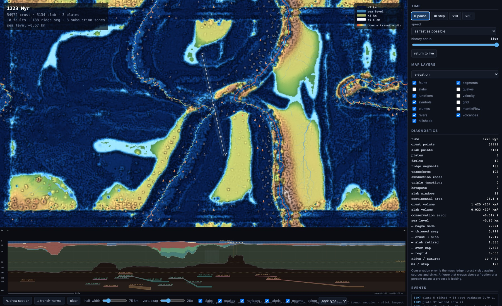
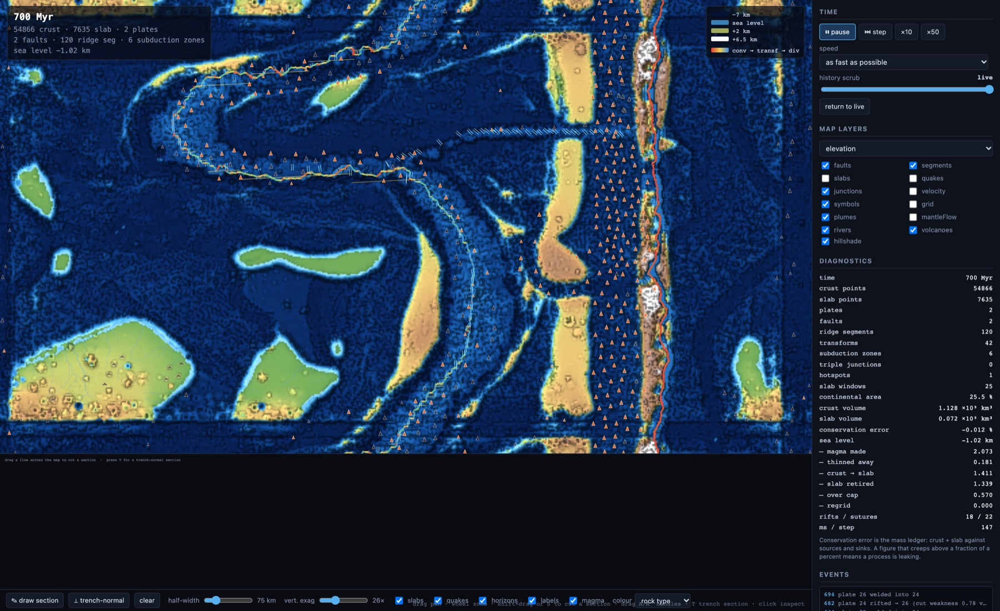
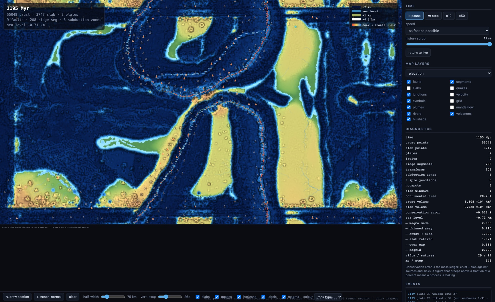

# 2D Plate Tectonics Simulator

A plate tectonics simulator on a flat torus. It runs in the browser on CPU and
evolves a world over hundreds of millions of years, producing continents, ocean
basins, mid-ocean ridge/transform staircases, fracture zones, trenches with
volcanic arcs, collisional orogens and rift valleys — **none of which are drawn
directly**. All of it emerges from plate motion, boundary rules and a physical
elevation model.



*One run at 1,223 Myr. The section below the map is cut perpendicular to the
nearest trench and is not an illustration — it is the simulation's own state,
read out along that line: slabs labelled by the plate they came from, magma,
crustal horizons, and the arc they feed.*

```
node serve.mjs          # then open http://localhost:8181/
```

ES modules will not load over `file://`, so it has to be served. There is no
build step and no dependency install; the one third-party library (Delaunator,
plus its `robust-predicates` dependency) is vendored in `src/vendor/`.

## The three principles the code is built around

**Crust lives on Lagrangian points, not a grid.** The simulation state is a
point cloud that moves with the plates (`CrustSet` in
[src/core/pointsets.js](src/core/pointsets.js)). A grid is produced each frame
for display only. Storing crust on a fixed grid and advecting it resamples
every step and blurs continents into mush within ~50 Myr of simulated time.

**Elevation is derived, never painted.** Height is a pure function of crustal
thickness, lithospheric thickness, density and seafloor age
([src/sim/elevation.js](src/sim/elevation.js)). Nothing anywhere assigns an
elevation. If something needs to be higher it gets thicker or younger. Mountain
roots, shelf breaks, ridge topography and post-orogenic rebound all come free.

**Plates break and merge.** Rifting splits a plate along a least-cost path that
follows inherited weakness ([src/sim/rifting.js](src/sim/rifting.js)); continental
collision welds two into one ([src/sim/processes.js](src/sim/processes.js)).
Together they generate Wilson cycles without any code that knows what a
supercontinent is.

## What a run actually produces

The same world, twice, from a single seed and nine starting plates:

<table>
<tr>
<td width="50%"></td>
<td width="50%"></td>
</tr>
<tr>
<td><sub><b>700 Myr</b> — down to 2 plates. A ridge/transform staircase runs
north–south, a trench on the right has built a dense volcanic arc, and
fracture zones comb the old seafloor.</sub></td>
<td><sub><b>1,188 Myr</b> — back up to 3. Rivers drain the orogens, shelves
have formed off every continent, and sea level has dropped 0.67 km as the
ocean basins aged and deepened.</sub></td>
</tr>
</table>

Nine plates became two and then three again. Nothing in the code knows what a
supercontinent is: rifting splits a plate along a least-cost path through
inherited weakness, collision welds two into one, and Wilson cycles are what
those two rules do when left alone for a billion years. The events log records
them as they happen — `plate 37 welded into 27`, `plate 5 rifted → 38 (cut
weakness 0.79)`.

The diagnostics panel carries a mass ledger: crust plus slab against every
source and sink, reported as a conservation error. It sits at −0.012 % after a
billion years. A figure that creeps above a fraction of a percent means a
process is leaking, which is the fastest way to find a bug in a simulation
where everything is supposed to be emergent.

## Layout

| path | what it is |
| --- | --- |
| [src/core/torus.js](src/core/torus.js) | `wrapDelta` / `wrapPos` / circular means. Every difference vector in the codebase goes through here. |
| [src/core/pointsets.js](src/core/pointsets.js) | Structure-of-arrays crust and slab point sets with free lists. |
| [src/core/plates.js](src/core/plates.js) | Plates, and the unwrapped local frame that makes rigid rotation well defined on a torus. |
| [src/core/spatialhash.js](src/core/spatialhash.js) | Wrapped uniform bucket grid, rebuilt each step. |
| [src/core/world.js](src/core/world.js) | Initial condition, the step pipeline, snapshots. |
| [src/sim/delaunay.js](src/sim/delaunay.js) | Periodic Delaunay by ghosting points across the seam. |
| [src/sim/boundaries.js](src/sim/boundaries.js) | Voronoi-dual boundary network, obliquity classification, stable fault IDs, triple junctions. |
| [src/sim/segments.js](src/sim/segments.js) | The ridge/transform orthogonal staircase, with persistent segment identity. |
| [src/sim/trenches.js](src/sim/trenches.js) | Subduction zones as explicit objects: locked polarity, trench position, hinge, rollback rate. |
| [src/sim/motion.js](src/sim/motion.js) | Force-balance plate kinematics and advection. |
| [src/sim/processes.js](src/sim/processes.js) | Accretion, subduction, wedge, arcs, collision, transform, orogenic collapse. |
| [src/sim/slablayer.js](src/sim/slablayer.js) | Slab descent and the feedbacks: flat slab, rollback, slab windows. |
| [src/sim/rifting.js](src/sim/rifting.js) | Plate stress state, rift nucleation, the cut, rift thinning and breakup. |
| [src/sim/fluvial.js](src/sim/fluvial.js) | Drainage: depression filling, D8 routing, stream-power incision, deltas. |
| [src/sim/volcanoes.js](src/sim/volcanoes.js) | Persistent volcanic vents that build real edifices. |
| [src/sim/density.js](src/sim/density.js) | Point insertion and merging; boundary cleanup. |
| [src/sim/diagnostics.js](src/sim/diagnostics.js) | Mass ledger and the earthquake catalogue. |
| [src/sim/geophysics.js](src/sim/geophysics.js) | Heat flow, gravity and strain rate, derived from the rasterised state. |
| [src/sim/mantle.js](src/sim/mantle.js) | Convecting temperature field, the flow solved from it, basal traction on plates, and hotspots. |
| [src/render/raster.js](src/render/raster.js) | Gaussian splat rasteriser. Raw fields first, elevation from them second. |
| [src/render/mapview.js](src/render/mapview.js) | Map drawing, 3×3 torus tiling, fault symbology. |
| [src/render/section.js](src/render/section.js) | Cross-section view: crustal profile, slab ribbons, horizons, annotations. |

## Using it

| | |
| --- | --- |
| drag | pan |
| wheel | zoom |
| click | inspect the nearest crust point |
| shift + drag, or `S` then drag | cut a cross-section line |
| drag the **A** / **A′** handles | move an end of the section |
| drag the midpoint handle | slide the whole section, keeping its bearing |
| `T` | section perpendicular to the nearest trench |
| `Esc` | leave section-drawing mode |
| `F` | fit the whole world to the view |
| space | play / pause |
| `.` | single step |

The cut is drawn on the map along with the corridor it actually samples, so
what the section shows and where it came from are never in question. Hovering
the section reports the depth, plate, crustal and lithospheric thickness,
composition and seafloor age under the cursor, and names any slab beneath it.

The right-hand panel carries the map layers, the diagnostics, the event log and
live sliders for every constant worth tuning. The history scrub replays
snapshots, which is how you work out why a feature formed.

### Map layers

Primary state: `elevation` (hypsometric, hard break at sea level), `crust`
(continental fraction), `age` (the classic seafloor rainbow — the single best
check that spreading works), `weakness` (inherited structure; confirms rifts
follow old scars), `stress`, `plates`, `slabDepth`.

Derived, computed from the rasterised fields in
[sim/geophysics.js](src/sim/geophysics.js) — nothing extra is simulated for
these:

| layer | what it is |
| --- | --- |
| `basement age` | time since the last deformation, from `defAge`. A basement-province map: young orogenic belts warm, cratons dark. |
| `heat flow` | conduction through the lithosphere plus radiogenic production in the crust. Because oceanic lithosphere thickens as √age this reproduces the 1/√age fall-off on its own — hundreds of mW/m² at a ridge axis, ~40 over old sea floor, 40–55 over a craton. |
| `Bouguer gravity` | the crustal root, by the slab formula. Strongly negative over orogens, positive over ocean basins. |
| `free-air gravity` | the mass anomaly of the whole column against a reference, down to a compensation depth. Identically zero wherever isostasy balances, so what shows is what is *not* compensated. |
| `strain rate` | relative velocity across each boundary, spread over the width it is taken up across, in nanostrain/yr. |

Overlays: the classified fault network coloured by obliquity, ridge segments
and transforms, geologic fault symbols, triple junctions, earthquakes, velocity
arrows, slab depth contours, **rivers** (straight off the drainage solve, width
following the square root of discharge the way a channel does), **volcanoes**
(filled triangles, tall and narrow for a stratocone, broad and flat for a
shield; hollow when dormant), and the cross-section line with its corridor.

Relief shading is on by default and is computed from a separate barycentric
reconstruction of the surface rather than from the colour field — see *Relief
shading gets its own reconstruction* below.

## Headless tools

```
node test/headless.mjs --steps=600 --every=100      # run and tabulate
node test/validate.mjs --steps=250                  # the spec's validation targets
node test/render-png.mjs --steps=200 --shots=0,100,200 --out=/tmp/pt
node test/section-png.mjs --steps=150 --out=/tmp/pt/section.png
node test/render-smoke.mjs                          # render path + snapshot round-trip
node test/section-geom.mjs                          # section geometry across the seam, handles
```

The headless tools render through [test/domstub.mjs](test/domstub.mjs), a
minimal DOM and canvas stub, so the whole draw path can be exercised — and PNGs
produced — without a browser.

`validate.mjs` checks the things the spec asks to be checked against
well-documented real-world behaviour rather than against aesthetics:

1. seafloor age against depth for crust of *normal* oceanic thickness,
   compared to the model curve — a plateau or an arc built on ocean floor rides
   higher by Airy and would make the curve look non-monotonic for a perfectly
   good reason
2. segment length against spreading rate, split at the distribution's quartiles
3. Wadati–Benioff geometry: depth against distance from the nearest trench, dip
   distribution, and how many zones are in flat-slab mode
4. crustal roots under high ground
5. fracture zones — age offsets across segment-stamp boundaries
6. that plates both break and merge
7. whether each rift's least-cost cut actually followed weaker, thinner
   lithosphere than the plate it crossed (recorded at nucleation, not inferred
   from whatever happens to be rifting when you look)
8. the mass ledger and continental persistence
9. the boundary inventory and triple-junction census, skipped when the world
   has assembled into fewer than three plates and legitimately has almost no
   boundary network
10. continental morphology — whether continents still have interiors or have
   been milled into ribbons along their active margins

## Notes on the model

**Age–bathymetry, not half-space cooling.** The sqrt(age) law is the
well-established part and holds to ~70–80 Myr; real seafloor flattens after
that. The two regimes are blended with a smoothstep. A pure exponential would be
linear in age at small *t* and would throw the sqrt relation away.

**Lithosphere is a separate layer.** Several processes here are lithospheric
rather than crustal — slab buoyancy, rollback, subduction polarity, rift
routing. Oceanic lithosphere follows `k·sqrt(age)`; continental has its own rule,
because cratonic roots exceed 200 km at ages in the billions.

**Subduction polarity is locked at initiation.** Ocean-under-continent is
deterministic; ocean–ocean is scored probabilistically from age, lithospheric
thickness, boundary weakness and a random term, then fixed. Re-scoring every
step makes boundaries flip and shreds the slab layer.

**Rollback is a state, not an inference.** Each subduction zone carries trench
position, trench velocity, hinge position and rollback rate, driven by slab
negative buoyancy, dip, length, convergence and trench anchoring.

**Mass is tracked explicitly.** The ledger separates magma production, thinning,
crust→slab transfer, slab retirement at 660 km, volume lost to the numerical
thickness cap, and the regrid term from point insertion and merging. The panel
shows the conservation error; a figure that creeps above a fraction of a percent
means a process is leaking. Accretionary wedge transfer, collisional shortening
and point merging all conserve volume — and continental content with it, which
is what stops continents evaporating over a few hundred Myr.

**Point density is managed.** Rifting stretches the cloud and collision
compresses it. Insertion fills Delaunay holes (thinning the donors, which is
what stretching does) and merging returns the dropped column to its
neighbourhood. A proportional controller on both thresholds holds the population
at the density every area budget assumes.

**Composition rides on mass.** Every path that changes a point's thickness also
sets the composition of the material it added — arc magma is andesitic, wedge
material is whatever was scraped off, slab-window volcanism is basaltic,
transpression stacks up whatever was already there. Raising `continental`
independently of thickness invents continental material, and because the arc
band sweeps across the overriding plate as it moves, it paints a thin wash of
half-continental crust over the whole ocean. Volume transfers prefer receivers
of similar composition for the same reason: oceanic points outnumber
continental ones so heavily that even a small residual weight bleeds the
continents into the sea floor.

**A jammed trench eventually welds.** Continental crust is too buoyant to
subduct, so when it arrives at a trench the convergence is taken up as
shortening instead. That counts toward the same closure budget a collision
does, so the two plates eventually suture and the convergence stops. Without
it, a trench grinds away at the margin indefinitely and mills the continent
into a narrow, absurdly over-thickened ribbon — which is what the validation's
morphology check is watching for.

**Plates are driven by a convecting mantle.** Motions used to come from an
Ornstein-Uhlenbeck random force — smooth and persistent, but meaningless.
[sim/mantle.js](src/sim/mantle.js) carries a coarse temperature-anomaly field,
heated from below, cooled through whatever lithosphere sits on top of it, and
chilled by the slabs falling through it. Flow comes from a warm-started
red–black SOR solve of `∇²φ = T′` on the torus, with `v = ∇φ`: divergence over
hot mantle, convergence over cold. Plates then feel a basal traction toward that
flow, plus the torque its shear exerts about their own pivot — which is where
plate rotation comes from now instead of a random number.

Three things follow that previously had to be faked or were simply absent.
Continents insulate for real: a craton with a 230 km root passes little heat, so
the mantle beneath it warms and puts the plate into extension — replacing the
`insulationStress` term that used to stand in for supercontinent breakup.
Downwellings are self-sustaining, because cold slab keeps the downwelling under
a trench alive after the slab itself has retired. And hotspots exist at all: they
are the persistent maxima of this field, anchored in the mantle rather than the
plates, so a plate drifting over one leaves an age-progressive chain of volcanic
edifices without any code that knows what a hotspot track is.

Two numerical details that are not optional. The cooling term relaxes
exponentially rather than as `T -= T*rate*dt`: thin lithosphere gives a decay
rate well above 2 per Myr, and the explicit form overshoots through zero and
doubles every step — the field reaches 1e50 within a few tens of Myr. And the
traction gradient is taken over a wide stencil, not between adjacent cells: a
cell-scale gradient alternates sign faster than a plate is wide, so averaging it
over a plate cancels almost to nothing and plates crawl no matter how hard the
coupling is turned up.

**Deformation is graded, not a switch.** `defAge` — time since the crust was
last deformed — used to be slammed to zero by every process that touched a
point, so a whisper of transpression aged a craton back to newborn. Nothing in
the model ever got old: no basement provinces, and no thick cratonic roots,
since the lithosphere target is keyed off exactly this. A collision now resets
the clock, a passing transform barely moves it, and cratons reach 220 km roots
with billion-year basement while active belts stay young.

**Thickened oceanic crust floats higher.** The age-depth curve describes
seafloor of *normal* crustal thickness; crust thicker than that rides up by
Airy. Without the term an oceanic plateau or a young island arc has no
bathymetric expression at all and nothing built on ocean floor can ever emerge.
The free-air gravity layer is what turned this up — a plateau was reading −226
mGal because its column was far too heavy for where the model was putting it.

**Slabs are drawn as sheets, not dots.** The one thing a section can show that
no map can is a plate beneath another plate, and a scatter of slab points does
not show it. Points are grouped by `slabId`, binned along the section and drawn
as a ribbon of the slab's own lithospheric thickness, tinted with the colour of
the plate it came from, with its subducted crust as a bright skin on top. The
surface band is tinted the same way and broken at every plate boundary the line
crosses, each labelled with what the boundary network says it is.

**Rivers, not just hillslopes.** Hillslope transfer is local: a column looks at
the ground beside it and moves material a short way downhill. Local rules make
smooth domes, because the thing that organises real topography is not local at
all — a river carries water that fell a thousand kilometres away and incises in
proportion to that accumulated discharge. So the surface gets a proper drainage
model on a grid: depressions are filled by priority flood (without it most of
the map is undrained pits and no network forms), flow is routed D8 down the
filled surface, drainage area is accumulated, and incision follows stream power
`dz = K·A^m·S^n` divided by the rock's resistance. The grid is a nearest-point
partition of the cloud, so mapping the result back onto the points is exact.

**Sediment that reaches the sea builds the margin.** The load does not vanish at
the shoreline: it spreads over the submarine cells around each river mouth,
preferring the deepest and never building above sea level. Dropping it instead
was deleting continental crust fast enough to stop continents rifting at all,
because there was progressively less continent to rift — the kind of error that
shows up three systems away from its cause.

**Volcanoes are edifices, not a welt.** Melt used to erupt wherever it happened
to be, so a 2000 km arc got a 2000 km low ridge. Real arcs collect their melt
into discrete, long-lived centres and each one builds a cone. A register of
persistent vents captures the melt rising under its neighbourhood — by nearest
vent, not first claim, or arc cones swallow the plume melt and no shields ever
form — and emplaces it as a radially decaying pile. Basaltic melt builds broad
shields, andesitic melt steep stratocones. Past a stable height the flanks fail
and the pile spreads, enforced as a hard per-point ceiling with redistribution;
a per-eruption test never holds, because a vent erupts onto the same summit
again and again.

**An edifice is not Airy-compensated.** A narrow load is carried by the strength
of the plate, not by a root, which is why Mauna Loa stands 9 km above the
seafloor instead of the 1.5 km local isostasy allows. Edifice height is tracked
apart from crustal thickness and enters elevation largely uncompensated, then
relaxes over ~90 Myr as the plate bends and a compensating root grows. That
relaxation is why ancient seamounts are drowned and young ones are islands.

**Different rocks weather at different rates.** Every rock type carries a
resistance, and erosion is divided by it. Stripping soft cover off a resistant
bed slows the attack to a crawl, so structure survives in the landscape; without
it, relief is a set of smooth domes.

**Relief shading gets its own reconstruction.** The colour map wants a wide
splat — it hides the point cloud and gives even fields. But that is a low-pass
filter and hillshading is a high-pass operation, so shading the colour field
shades a surface whose detail has already been averaged away. A narrower splat
is no better: a tight Gaussian turns every point into a visible disc. What is
wanted is an *interpolant*, so the shading is computed from the elevation
interpolated barycentrically over the Delaunay triangulation the simulation
already maintains. Nothing is invented and nothing is averaged. Elevation and
distance are both in kilometres, so a real continental slope is a few parts per
thousand; the vertical is exaggerated for shading, as on any relief map.

**Orogenic collapse.** Crust well above the orogenic root cap flows laterally in
the lower crust. This is not erosion — nothing leaves the plate and nothing is
carried downhill by water — it is the mass-conserving flow that turns a needle of
over-thickened crust into a plateau. Without it, thickening processes saturate a
handful of points and the overflow has nowhere to go.

The rule was originally downhill-only, which fails in exactly the case it exists
for: a collision thickens every point in the orogen at once, so in the interior
nobody has a downhill neighbour and nothing moves. That is how crust reached
120 km here when the thickest on Earth is about 80. Past roughly 60 km the
lower crust is hot enough to flow and the orogen's own weight drives it outward
whether or not there is a local slope, so above that limit material is pushed
into the thinnest neighbours regardless of gradient, at a rate that climbs
steeply with the excess. Peak elevation fell from 12.4 km to about 9.

**Over-thickened roots founder.** Mafic lower crust that crosses into the
eclogite field becomes denser than the mantle under it and drops off. Note the
sign of the effect: delamination removes dense material, so the column gets
*lighter* and the surface goes UP, as under the Sierra Nevada. It is not what
limits peak elevation — collapse is.

## Build order

All twelve milestones from the spec are in and visually verifiable:

| # | milestone | where |
| --- | --- | --- |
| 1 | torus domain, point cloud, plates, advection | [core/torus.js](src/core/torus.js), [sim/motion.js](src/sim/motion.js) |
| 2 | Delaunay + Voronoi boundary extraction | [sim/delaunay.js](src/sim/delaunay.js), [sim/boundaries.js](src/sim/boundaries.js) |
| 3 | obliquity classification + 2D colormap | [sim/boundaries.js](src/sim/boundaries.js), [render/colormaps.js](src/render/colormaps.js) |
| 4 | splat rasteriser + isostasy + age–depth | [render/raster.js](src/render/raster.js), [sim/elevation.js](src/sim/elevation.js) |
| 5 | cross-section view | [render/section.js](src/render/section.js) |
| 6 | accretion + subduction | [sim/processes.js](src/sim/processes.js) |
| 7 | slab layer + Wadati–Benioff | [sim/slablayer.js](src/sim/slablayer.js), [sim/trenches.js](src/sim/trenches.js) |
| 8 | flat-slab and rollback feedbacks | [sim/slablayer.js](src/sim/slablayer.js) |
| 9 | ridge segmentation staircase | [sim/segments.js](src/sim/segments.js) |
| 10 | fracture zones + weakness | segment stamping in [sim/processes.js](src/sim/processes.js) |
| 11 | rifting + suturing | [sim/rifting.js](src/sim/rifting.js) |
| 12 | long-run tuning | [test/validate.mjs](test/validate.mjs), the panel sliders |

Plus the addendum's items: unwrapped plate frames, explicit trench/hinge state,
the corrected age–bathymetry blend, a lithosphere layer, locked probabilistic
subduction polarity, the mass ledger, arc depth as a target band, triple
junctions, diagnostic earthquakes, stress-first rift nucleation, weakness- and
noise-modulated `L_seg`, slab identity, and point-density management.

## Out of scope for v1

Erosion and sedimentation; spherical geometry, projections and Euler poles;
climate, hydrology and biomes; solved mantle convection; second-order ridge
segmentation. The elevation model is arranged so erosion can later be added as a
mass-transfer step feeding back into isostasy.

## Tuning

Expect most of the work to be tuning rather than implementation. The seed plus
the configuration fully determine a run, so a promising world can be reproduced
exactly. The parameters worth reaching for first are `L_seg`, the weakness
half-life, the rift trigger threshold, the slab sink rate, the wedge transfer
fraction, and the isostatic `DATUM`.

## References

- Cortial, Peytavie, Galin & Guérin (2019), *Procedural Tectonic Planets*,
  Computer Graphics Forum 38(2) — approximates subduction and collision
  procedurally rather than physically, which is the right trade-off here. It
  works on a sphere; this is adapted to the torus.
- Lauri Viitanen, *platec* — a C++ point-based 2D plate tectonics library, useful
  reading on collision bookkeeping.
